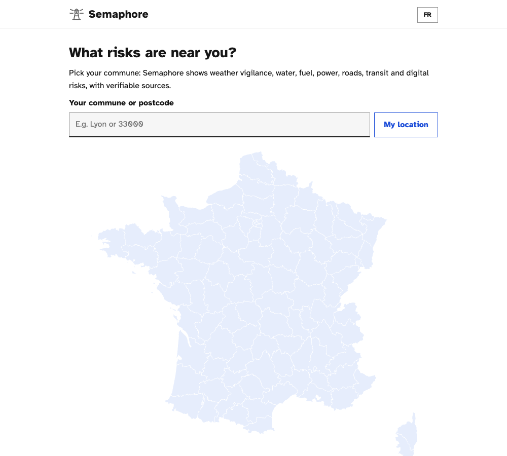
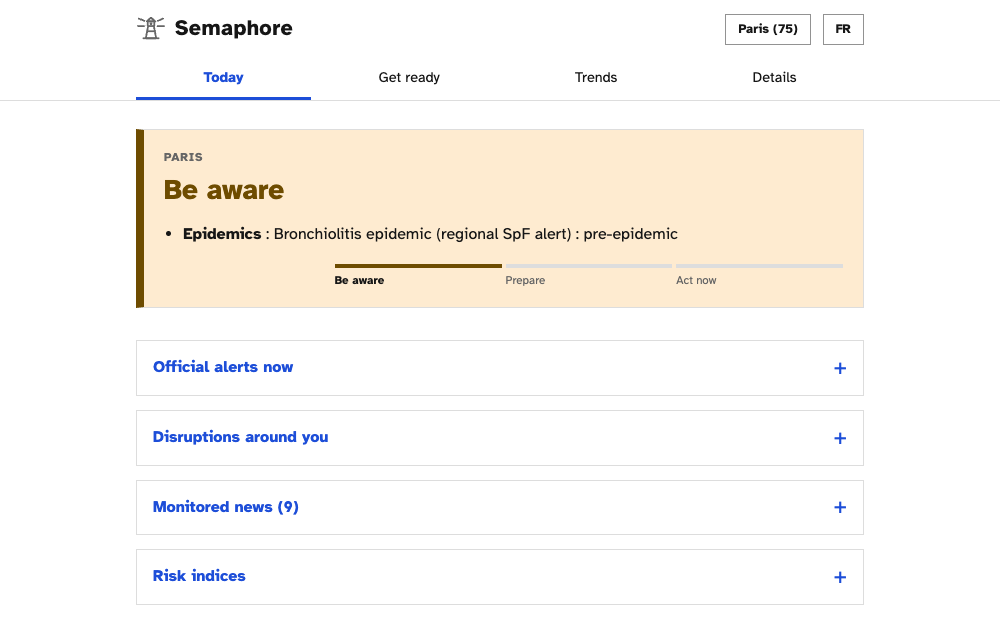
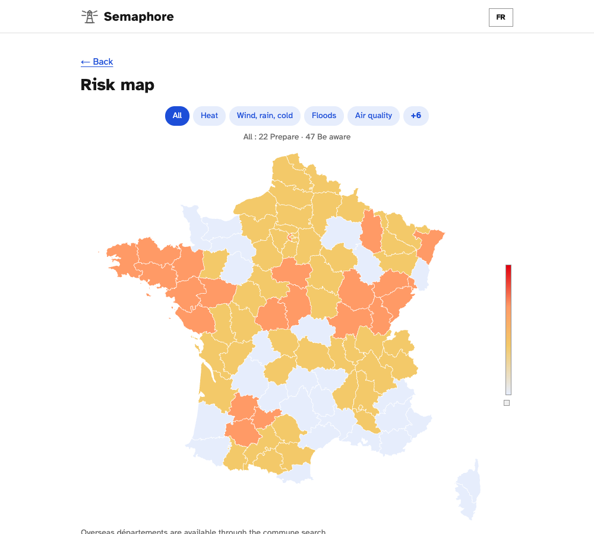
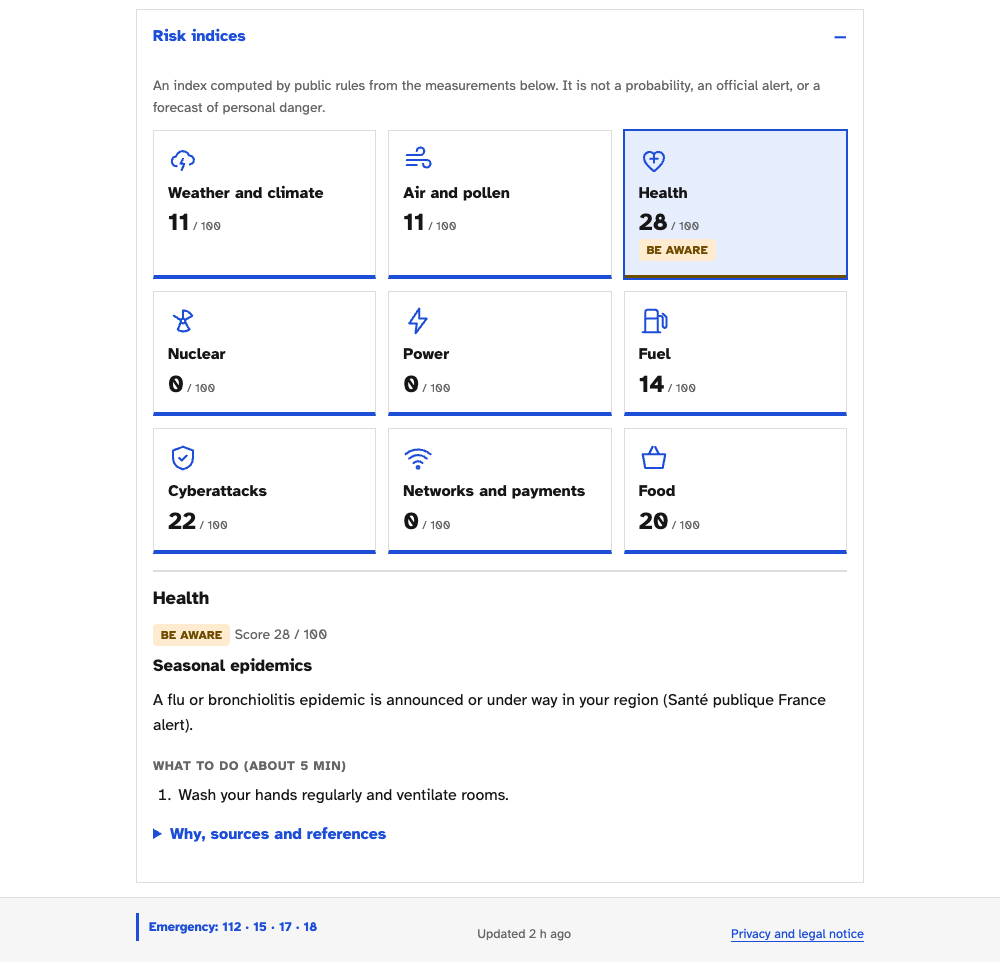
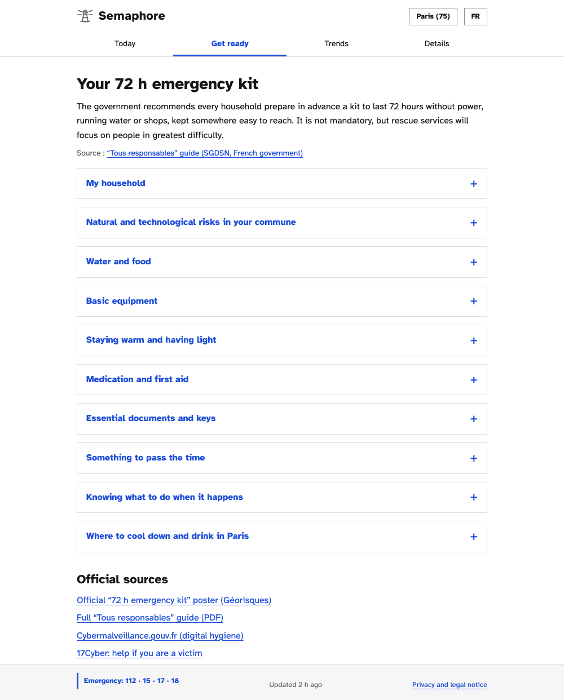
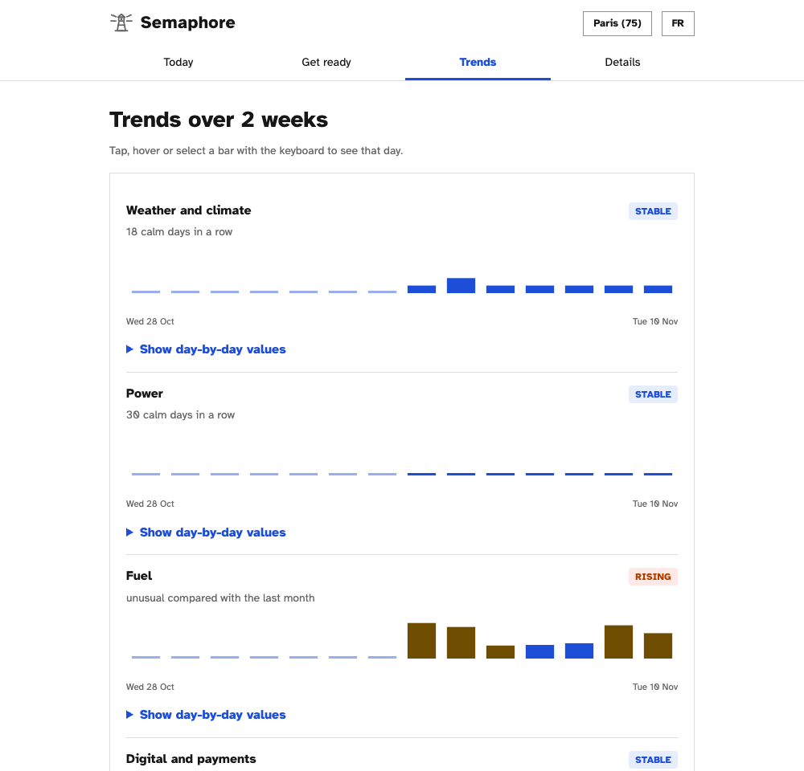

<p align="center"></p>

<h1 align="center">Semaphore</h1>

**Is anything going wrong near you right now, and what should you do?** Semaphore answers that for any commune in France, on one page, from public open data and fixed, readable rules.

<p align="center"><b><a href="https://dsleo.github.io/semaphore/">Open the live site →</a></b></p>

<p align="center"></p>

- **Free, no tracking.** No account, no cookies, no analytics. Your commune is sent to the public data services it queries ([details](docs/privacy.html)).
- **No AI deciding anything.** Every level comes from a rule you can read. No LLM, front or back.
- **Independent.** Not an official service and never presented as one. It points you to the official sources (Météo-France, Vigicrues, RTE, FR-Alert, 112).
- **Honest about gaps.** A source that is down shows as "unavailable", never as "all clear". The calm state says *"Nothing to report… This is not an all-clear."*

<details open>
<summary><b>Check any commune</b></summary>

Type a commune or postcode, or use your location. You get a single status (*Everything's fine → Be aware → Prepare → Act now*), the official alerts in force, and the reasons behind the level. Your choice lives in the URL, so you can share it.

<p align="center"></p>

</details>

<details open>
<summary><b>See France at a glance</b></summary>

A map coloured per département, one layer per risk: heat, wind/rain/cold, floods, drought, fuel, air quality, pollen, wildfire, epidemics, nuclear incidents. Each layer has a one-line summary, so a calm layer reads as checked, not blank.

<p align="center"></p>

</details>

<details open>
<summary><b>Know what is disrupted around you</b></summary>

Roads (Bison Futé), public transport alerts from about 75 networks, city works and events in Paris, and local press headlines that mention a crisis. All filtered to your commune.

</details>

<details open>
<summary><b>See why, not just a number</b></summary>

Each risk has an index out of 100, a plain-language "what to do", and the evidence behind it with source, time and link. The index is explicitly not a probability and not an official warning.

<p align="center"></p>

</details>

<details open>
<summary><b>Get ready before something happens</b></summary>

A 72-hour emergency kit based on the government's guide, a checklist saved only in your browser, key numbers, your commune's natural and technological risks (Géorisques), and in Paris where to cool down and drink.

<p align="center"></p>

</details>

<details open>
<summary><b>Watch the trend</b></summary>

Fourteen days per risk group: rising, stable or easing, with calm streaks. Pale bars are reconstructed from archives, solid bars were measured live.

<p align="center"></p>

</details>

<details open>
<summary><b>What it watches</b></summary>

Weather vigilance and forecasts, floods (Seine), electricity (Ecowatt), fuel stations, water restrictions, air quality, pollen, wildfire, epidemics, nuclear incident notices, cyber and internet outages, and press. Paris gets the full set (15 sources, traffic, cooling places); other communes get the live local ones plus national signals. Power outages are not covered locally: no open feed exists, and the page says so.

</details>

<details open>
<summary><b>Limits, plainly</b></summary>

- Thresholds are starting defaults, not yet calibrated against real events. Compare with official warnings.
- It cannot read FR-Alert or préfecture alerts automatically.
- **It does not replace official alerts. When FR-Alert, your préfecture or the authorities say something different, follow them.** Emergency: 112 · 15 · 17 · 18.

</details>

<details open>
<summary><b>Run it yourself</b></summary>

Python 3.9+, nothing to install.

```bash
python3 -m semaphore --serve        # refresh data, then serve http://localhost:8000
python3 -m unittest -q          # tests
```

On GitHub, an Action refreshes the data (a self-chaining job that collects every 15 min) and commits it; Pages serves the `docs/` folder.

</details>

<details>
<summary><b>Technical overview</b> (scoring rules, architecture, sources, memory, review guide, known limits)</summary>

Further design docs: [SPEC.md](SPEC.md) (product and safety design) · [RISK_REGISTER.md](RISK_REGISTER.md) (hazards and data map).

### Any commune in France

The first screen is a commune picker (autocomplete on `geo.api.gouv.fr`, postcode, or geolocation) and a map of France coloured by Météo-France vigilance per département. The choice lives in the URL (`?c=<INSEE code>`), so it can be shared.

- **Paris** (75056) is served exactly as before from the Action-built `state.json`: all 15 sources, trends, traffic, cooling places.
- **Any other commune**: `docs/local.js` fetches the local sources live in the browser (Open-Meteo forecast at the commune's coordinates, Météo-France vigilance for its département, VigiEau at its coordinates, fuel stockouts in its département) and scores them with a port of `semaphore/score.py` (same noisy-OR, impact, official floors, fuel cap). National hazards (power, cyber, digital, supply) come from `state.json`. Not available outside Paris: traffic events, cooling places, trends for local hazards, level-change history, Seine gauge. Unavailable sources show as "indisponible", never as "all clear".
- **Local layers** (any commune, including Paris), built by the Action in `semaphore/local.py` as static JSON and filtered in the browser: `news-local.json` (France 3 régions, ici and regional dailies, crisis keywords in the title, matched to commune / département / region), `roads.json` (Bison Futé DATEX II events within 25 km, national non-conceded network only), `transit.json` (GTFS-RT service alerts from ~75 networks on transport.data.gouv.fr, matched by commune, EPCI, département or region; a network that is not read is never shown as "no disruption"). The browser also calls Géorisques live for the commune's risk profile (Se préparer tab).
- **Power outages**: Enedis publishes no current-outage open data, so Semaphore shows the national Ecowatt/eco2mix signal plus a link and the département breakdown line, and says so.
- Local levels have no persistence/hysteresis (no per-visitor history). The heat threshold outside Île-de-France is an approximate national one (34/20 °C); the official canicule vigilance has the exact values.
- `scripts/build_map.py` regenerates `docs/data/france-map.json` from a départements GeoJSON. `node tests/local.test.js` checks the scoring port.

### Risk map (per département)

`semaphore/depts.py` scores every hazard for each metropolitan département with the same rules as `score.py` (no damping: there is no per-département history) and writes `docs/data/depts.json`, at most hourly (Open-Meteo is rate limited). The home map has one layer per hazard, each with a one-line summary, so a calm layer is visibly checked rather than blank.

- Layers beyond the national hazards: **air quality** (ATMO France index, Open-Meteo/CAMS fallback), **pollen** (ATMO), **wildfire** (Météo des forêts), **health** (Santé publique France epidemic alerts) and **nuclear** (ASNR incident notices, sites in `semaphore/nuclear_sites.json`).
- These five are read for the chosen commune's département in the commune view.
- Each source fails alone: its layer is then unknown for every département, never "all clear". These sources are reported in `depts.json`, not in `state.json`'s 15.

### What the user sees

Four tabs, French and English, light and dark mode:

| Tab | Content |
|---|---|
| **Aujourd'hui** | In this order: (1) a status banner, with the source coverage ("15 of 15 sources current"). The calm state reads *"No priority alert detected in the monitored sources, as of HH:MM. This is not an all-clear"*; (2) **official alerts now** (Météo-France, Vigicrues, Ecowatt, VigiEau), kept apart from scores; (3) **local disruptions** (Paris traffic events); (4) the **Semaphore risk indices** (icon, score /100, level badge), explicitly not a probability or an official warning; tap one for what to do and the evidence; (5) links to preparedness and method. |
| **Se préparer** | The 72-hour emergency kit from the official government guide: persons counter, checklist saved in the browser only, "know" list (FR-Alert, sirens, 112/15/17/18, how to judge information), and **where to cool down and drink** by arrondissement (Paris open data, with the last-checked date; no geolocation). |
| **Tendances** | Last 14 days per risk group: rising / stable / easing, calm streak, "unusual" flag. Hover or tap a bar for the day's date, level and score. Pale bars are reconstructed, solid bars are live. Each chart has a keyboard-reachable table version. |
| **Détails** | Collapsible sections: how the level is decided, current measurements, monitored press, data sources, change history, traceability and limits. |

### How a level is decided

All of it is deterministic and in `semaphore/score.py` (about 80 lines) plus the stress rules in `semaphore/sources.py`.

1. **Indicator stress** `s` in [0, 1]. Each collector turns a raw measurement into a stress with a piecewise-linear rule (e.g. share of stations out of fuel, 3-day mean temperature, Seine height and rise rate, Ecowatt colour).
2. **Hazard score.** Indicators are grouped into *evidence families* (a forecast and the warning built on it, readings of one feed, press repeating one story). Only the strongest `w·s` of each family counts, then families combine with a *noisy-OR*: `H = 100 × (1 − Π(1 − fᵢ))`. Independent evidence corroborates, repeated evidence does not inflate. Items of kind `context` (CISA KEV, CERT-FR, RansomLook, ENSO) are displayed but never scored. `w` is the trust weight of the indicator.
3. **Impact.** `R = H × (0.6 + 0.1 × (impact − 1))`, with impact 1 to 5 per hazard (`semaphore/config.json`).
4. **Levels.** R below 25: Tout va bien. 25 to 49: À surveiller. 50 to 74: Préparez-vous. 75 and above: Agissez maintenant.
5. **Official floors.** Météo-France Vigilance, Vigicrues (orange or red) and Ecowatt set a minimum score (50 or 80) and bypass persistence. Official alerts are also listed on their own on the home screen.
6. **Damping.** A rise needs confirmation over 2 runs (official signals excepted). A fall drops one level per 6 h. This avoids flapping.
7. **Safety caps.** Fuel and supply are capped at "Préparez-vous" unless an official source confirms, and their wording says *don't hoard*. Press feeds only a few capped indicators, counted per distinct *event* (near-duplicate headlines group together), so press alone never exceeds "À surveiller" or "Préparez-vous".
8. **Unknown is never OK.** A hazard with no scored indicator is "unknown". Each source has its own expected refresh (15 min to a month, `META` in `sources.py`); a source that failed but is within 3× its interval is shown as *late*, otherwise *unavailable*, and tiles say "données partielles". If the national data file is older than 3 h, the page shows a stale-data warning.
9. **City level** is the worst hazard, and the city score is the highest hazard score. "Several domains affected" (two domains at Orange or above) is shown as a fact; it adds nothing to the number. Flood, heat, drought and wind/rain/cold share the *weather* domain.

The deployed page shows the same explanation (Détails → "Comment le niveau est décidé").

### Architecture

```
semaphore/                     Python 3, standard library only
  sources.py   15 collectors, per-source metadata (kind, area, refresh, licence, family), stress rules
  places.py    cooling places and drinking fountains (Paris open data, refreshed daily)
  score.py     noisy-OR, impact, levels, persistence, hysteresis, headline
  memory.py    daily memory (memory.json) + trend rules (no ML)
  backfill.py  rebuilds past days from public archives
  depts.py     per-département scoring and risk-map layers (depts.json)
  local.py     news-local, roads, transit static layers
  run.py       collect (thread pool) -> score -> write JSON
  config.json  hazards (14): domain, impact, persistence, sources
docs/                      the static site (GitHub Pages serves this folder)
  index.html, app.js, local.js, style.css    vanilla JS/CSS, no framework, no build step
  data/state.json          current scores, evidence, trends, sources (generated)
  data/history.json        level-change log (generated)
  data/memory.json         one peak score per hazard per day, 30-day cap (generated)
  data/depts.json          per-département levels for the risk map (generated, hourly)
  data/news-local.json, roads.json, transit.json, vigicrues.json   local layers (generated; vigicrues = river sections above green, matched within 5 km of a commune)
  data/places.json         cooling places and fountains, with last-checked date (generated daily)
  data/messages.json       FR/EN texts per hazard: what / do / don't / references (hand-written)
  data/prepare.json        emergency kit and "know" list (hand-written)
tests/                     64 unittest tests + a JS test: scoring, Python/JS parity (shared fixtures), collectors with a mocked
                           network, memory, news filter, commit policy, and replayed scenarios
                           (2003 heatwave, red vigilance, 2016 Seine flood, calm day, double counting,
                           stale or missing feeds, DST day boundaries)
.github/workflows/update.yml   cron hourly: unit tests, JS scoring-port test, collect, commit docs/data
```

Flow: `python3 -m semaphore` runs every collector in parallel. A collector that fails never stops the run; it is reported as failed in `state.json`. Each indicator carries its value, source, timestamp, a SHA-256 fingerprint of the raw response and the API query so a reader can reproduce it. The scorer produces hazard states, the run records the day in memory, and the page renders everything client-side from `state.json`.

#### Sources (15)

| Source | Use |
|---|---|
| Fuel stations feed (data.economie.gouv.fr) | share of Île-de-France stations in stockout |
| Ecowatt, eco2mix (RTE via ODRE) | electricity tension signal, national load |
| Open-Meteo | heat, cold, wind, rain forecast |
| **Météo-France Vigilance** (Opendatasoft mirror, department 75) | official orange/red for heat, weather, flood |
| **Vigicrues** (official flood vigilance, section "Seine à Paris") | official flood level, scored as an official alert |
| **Paris traffic events** (Ville de Paris open data) | local disruptions list, not scored |
| Hub'Eau | Seine level and rate of rise |
| VigiEau | water restrictions |
| CISA KEV, CERT-FR, RansomLook | cyber **context**: displayed, never scored (they do not show a threat to Paris residents) |
| IODA | internet outages (Georgia Tech) |
| Press RSS (franceinfo, ici, 20 Minutes, Le Figaro, RFI, Le Monde) | keyword themes over the last 36 h; shown in Détails, plus capped cyber, cold-chain and bank signals when several distinct outlets agree |
| NOAA ONI | ENSO context only (no score) |

Préfecture, gouvernement.fr and interieur.gouv.fr block automated reads and publish no open alert feed. They appear as links, and through press coverage. No open FR-Alert feed exists.

#### Memory and trends

Each indicator records its kind (observed, official, forecast, reported, context), area (Paris, Île-de-France, France, world, single point), publication time when the source gives one, and fetch time. The Détails tab lists each source's expected refresh and licence.

Every run stores the day's peak per hazard in `memory.json` (Paris-time day), calm days included. Live readings always overwrite reconstructed ones. `memory.trends` builds one series per domain plus "all" (30 days stored, 14 shown): last 3 days vs the previous 7 (±5 points = rising / easing), calm streak, and "unusual" when the z-score against the older history is at least 2. That label needs **20 days** of history (the memory keeps 30); before that the page says so. With too little data it says "no data" rather than guessing.

`python3 -m semaphore.backfill 30` rebuilds the past from archives (fuel, observed weather, Seine about 1 month, Ecowatt, CISA KEV). Cyber is not backfilled. Limits: fuel history is a lower bound (the feed lists only stations still in stockout), weather uses observed values rather than forecasts, and VigiEau, IODA, RansomLook, press and probes have no archive, so those days stay empty. The backfill reuses the same stress functions as the live collectors, so thresholds cannot drift.

### Run it

Python 3.9+, nothing to install.

```bash
python3 -m semaphore --serve        # refresh data, then serve http://localhost:8000
python3 -m semaphore.backfill 30    # optional, once: rebuild 30 days of history
python3 -m unittest -q          # tests
node tests/local.test.js        # browser-side scoring port
```

To only view the existing data: `python3 -m http.server 8000 --directory docs`.

**Unattended and free, on GitHub:** push the repo, then Settings → Pages → Deploy from branch → `main` / `docs`. The workflow runs hourly, tests, collects and commits the generated `docs/data/*.json` (state, history, memory, places, depts and the local layers). Each commit is a timestamped snapshot, but quiet runs are not committed (`scripts/should_commit.py`: a run is committed when a level, alert, source status or carried-over counter changed, a score jumped by 5 points, or 30 minutes passed), which keeps history growth to roughly 100-200 MB a month instead of several times that. GitHub pauses scheduled runs after 60 days without repository activity.

**Keeping it fresh.** GitHub's own cron is best effort (in practice every few hours), so the `update` workflow chains itself: each run collects every 15 min for about 5 h 40 min (`scripts/refresh-loop.sh`), then starts the next run with `workflow_dispatch`. The hourly cron only restarts the chain if it ever breaks, and `concurrency` keeps one run active and at most one waiting. Quiet iterations are not committed (see the commit policy above). If a run fails 3 times in a row it opens a `pipeline-down` issue assigned to the repository owner (so GitHub notifies them) and closes it again on recovery; `watchdog.yml` does the same with a `data-stale` issue when the published data is over 12 h old. No token or external service is needed.

**History size.** If the repository grows too large over time, move the generated data to an orphan branch that is force-pushed (history of data is then not kept), or squash old data commits.

Measured (packed): a data commit costs about 25–40 KB, so at most about 50 MB a month at the 30-minute commit floor (set `SHOULD_COMMIT_MIN_MINUTES=60` to halve it). To squash old history, run the manual `compact-history` workflow; it is a dry run by default, backs up `main` first, and is described in [scripts/compact-history.md](scripts/compact-history.md). It rewrites `main`, so never run it unattended.

**Data licences.** The code is MIT. The data files in `docs/data/` are derived from open data published under their own licences (see [DATA.md](DATA.md)); reuse them under those terms. Set `"repo"` in `semaphore/config.json` to show the repo link in the app.

### Review guide

Where to look first:
- `semaphore/score.py`: the whole decision logic. `tests/test_score.py` pins its behaviour.
- `semaphore/sources.py`: the stress thresholds (top of file and each collector) and the press filter (`news()`: keyword themes, EXCLUDE list, local-only themes, outlet counting).
- `semaphore/config.json`: weights per hazard, impact, persistence. Also the level and heat thresholds. Each run publishes the rules the browser needs as `docs/data/config.json`, so the site's commune scoring reads them from there. Only the algorithm itself exists twice (Python and `docs/local.js`), kept aligned by the parity tests.
- `docs/data/messages.json` and `prepare.json`: all advice text. Worth a content review by someone competent in civil protection.
- `docs/app.js`: rendering only; it contains no scoring.
- `tests/test_scenarios.py`: the replayed known events and failure modes. Add a case whenever a real miss or false alarm is found.

### Known limits

- **Thresholds are starting defaults**, not calibrated. Run for several weeks and tune `sources.py` and `config.json`. Seine thresholds (3/4/5/6 m at Austerlitz) are placeholders to confirm with Vigicrues.
- Reachability probes of banks, retailers and telecoms were removed: one vantage point cannot tell a Paris outage from a local one, and probing third-party sites every 15 minutes is not ours to do.
- Ecowatt via ODRE is the day's colour and lags about a day. The RTE API (free key) would give the 3-day forecast.
- No open feed exists for strikes, local power cuts (Enedis), tap-water incidents or physical attacks. Press coverage and official alerts (FR-Alert, 112) remain the answer.
- The supply cluster has no history yet. Backfilled trends are partial and conservative.
- **Shadow mode is off** (`"shadow": false` in `config.json`; set it to `true` to show a trial banner). The thresholds are still uncalibrated, so keep comparing against official warnings for several weeks (missed warnings and false alarms).
- Runs unattended on GitHub Actions. Checked in a browser (mobile and desktop, light and dark; badge and text contrast at least 4.5:1; keyboard-reachable chart bars, skip link, no live-region re-announcements), but **not** with a real screen-reader or a formal accessibility audit (RGAA).
- Not integrated, on purpose: Île-de-France Mobilités disruptions, Airparif, the RTE Ecowatt API (accounts or keys; they would go in GitHub Actions secrets, never in the repo or JSON), GDELT, RIPE Atlas, Eau de Paris works, Enedis (no live feed). No map yet for local disruptions. Raw API responses are not archived (fingerprints and queries are, which do not allow an exact replay if upstream changes).
- Official FR-Alert and préfecture alerts cannot be read automatically; the page says so.
- This is not a substitute for official alerts. When FR-Alert, the préfecture or the authorities say something different, follow them.

</details>
